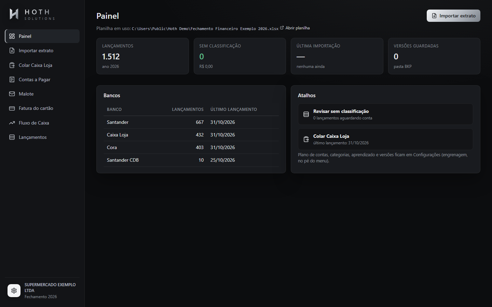
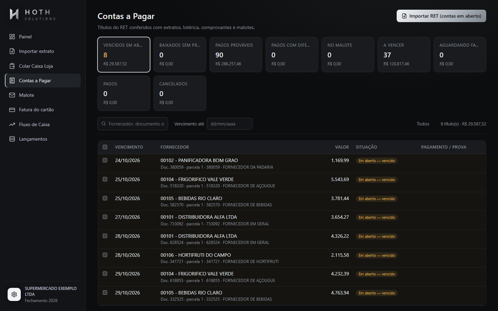
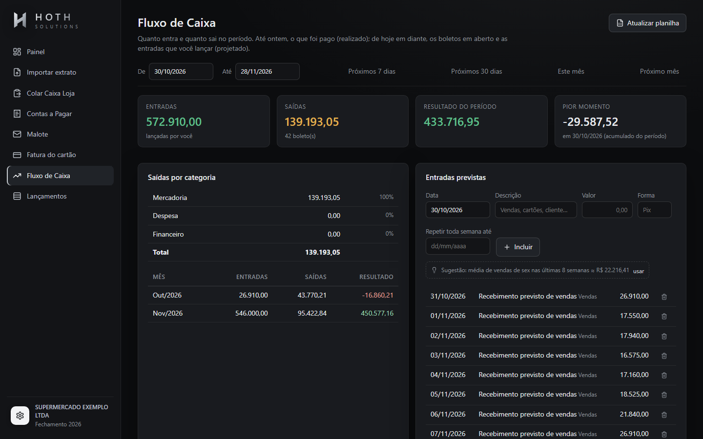
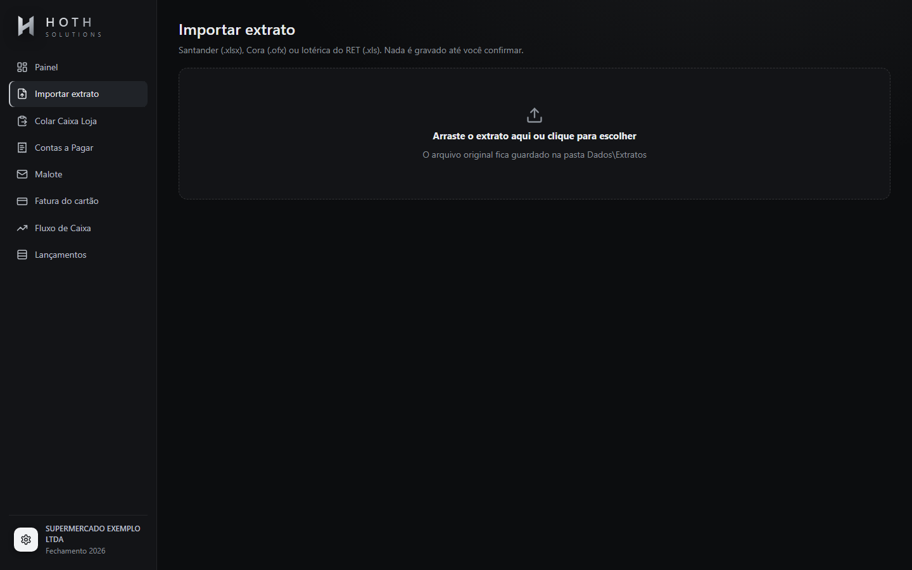
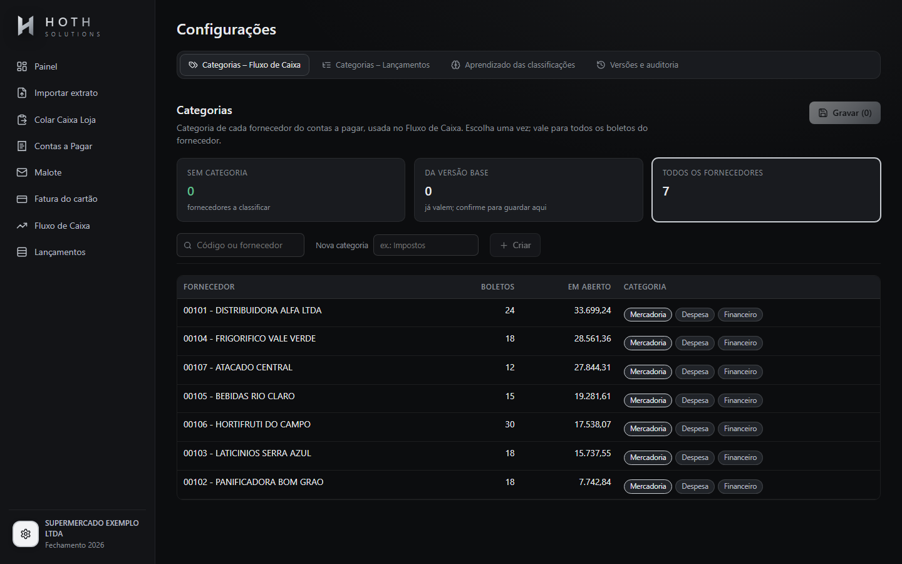

# Hoth Finance

**Fechamento financeiro e fluxo de caixa para supermercados, com classificação que aprende e conciliação automática.**

App desktop feito para o dia a dia do financeiro de um supermercado. Ele importa extratos bancários, classifica cada
lançamento no plano de contas, confere as contas a pagar com os pagamentos e mantém a planilha de fechamento
(DFC + DRE) e o fluxo de caixa sempre atualizados, sem digitação manual.

> Os nomes de empresa, fornecedores, pessoas e caminhos de rede deste repositório são fictícios.



---

## Telas

| Contas a pagar conciliadas | Fluxo de caixa |
|---|---|
|  |  |
| **Importar extrato** | **Categorias por fornecedor** |
|  |  |

## O problema

O fechamento mensal era feito à mão. Era preciso copiar extratos de vários bancos para uma planilha, classificar
centenas de linhas uma a uma, conferir boleto por boleto se cada conta tinha sido paga e remontar o fluxo de caixa.
Isso tomava dias por mês e gerava erros: o mesmo fornecedor caía em contas diferentes, pagamentos ficavam sem
conferência e o fluxo saía desatualizado.

## A solução

| Antes | Com o Hoth Finance |
|---|---|
| Copiar e colar extratos | Arrastar o arquivo (Santander .xlsx, Cora .ofx, relatório da lotérica) |
| Classificar linha a linha | O app propõe a conta e **aprende** com cada correção |
| Conferir pagamento de cada boleto | Conciliação automática com banco, caixa, comprovantes e malote |
| Montar DFC/DRE à mão | Planilha refeita por fórmulas a partir de uma única tabela de lançamentos |
| Fluxo de caixa defasado | Fluxo projetado regenerado a cada importação |

## Principais funções

- **Importação de extratos**: leitores para vários formatos bancários, com detecção de duplicidade e cópia do
  arquivo original.
- **Classificador que aprende**: regras fixas, histórico por fornecedor/contraparte e similaridade de texto. Cada
  proposta mostra a confiança (verde = aplicar, amarelo = revisar).
- **Contas a pagar e conciliação**: cada título é procurado em todos os bancos, em uma sequência de provas, da mais
  forte para a mais fraca: marcas → código + documento → código + valor → comprovante → malote → nome do fornecedor
  → só valor. O resultado é um status claro: pago e conferido, provável, no malote, vencido ou a vencer.
- **Fatura do cartão**: lê o PDF protegido da fatura e troca o débito único do extrato pelas compras, cada uma na
  sua conta.
- **Fluxo de caixa**: entradas e saídas por categoria e por dia (pago na data do pagamento, em aberto no vencimento).
- **Plano de contas editável**: criar, mesclar e reordenar contas e grupos. A DFC e a DRE se refazem sozinhas.
- **Segurança da planilha**: toda gravação exige o arquivo fechado, guarda uma versão no backup e registra a
  operação numa aba de auditoria. Qualquer versão anterior pode ser restaurada.

## Tecnologias

- **Backend**: Python 3.12, FastAPI, Uvicorn
- **Frontend**: React 18 + TypeScript, Vite
- **Desktop**: pywebview (janela nativa) e PyInstaller (instalador)
- **Planilhas e documentos**: openpyxl, xlrd, Excel COM (pywin32), pypdf, msoffcrypto-tool
- **Testes**: pytest (44 testes)

## Arquitetura

```
frontend/ (React + TS)  ──HTTP──▶  hoth/web/api.py (FastAPI)  ──▶  núcleo em hoth/
                                                                  ├─ leitores.py      extratos de cada banco
                                                                  ├─ classificador.py regras + aprendizado
                                                                  ├─ conciliacao.py   contas a pagar × pagamentos
                                                                  ├─ fatura.py        PDF da fatura do cartão
                                                                  ├─ fluxo.py         fluxo de caixa projetado
                                                                  ├─ gravacao.py      escrita segura + backup + auditoria
                                                                  └─ modelo.py        planilha DFC/DRE por fórmulas
```

O app roda só na máquina local (127.0.0.1), dentro de uma janela própria.

## Como rodar

Requisitos: Windows, Python 3.12, Node 20 e Excel (usado para a gravação via COM).

```bash
python -m venv .venv
.venv\Scripts\pip install -r requirements.txt
cd frontend && npm install && npm run build && cd ..
.venv\Scripts\python scripts\gerar_demo.py
copy hoth.exemplo.json hoth.json
"Abrir Hoth.bat"
```

Testes:

```bash
.venv\Scripts\python -m pytest tests
```

O `gerar_demo.py` cria em `Demo/` uma planilha com 1.512 lançamentos fictícios e um contas a pagar de exemplo.

O guia completo de uso de cada tela está em [docs/GUIA-DE-USO.md](docs/GUIA-DE-USO.md).

## Autor

Desenvolvido por **Hugo Hoth** (Hoth Solutions).
